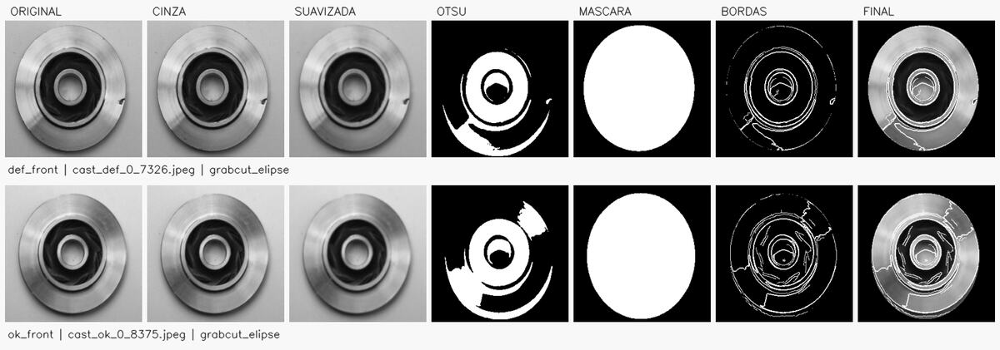

# Pré-processamento de imagens de peças fundidas com OpenCV

Mini-projeto avaliativo de Machine Learning e Visão Computacional, Módulo 2, Semana 07. O programa prepara imagens de peças metálicas para uma possível etapa futura de aprendizado de máquina. **Ele não classifica defeitos:** as pastas `def_front` e `ok_front` são preservadas apenas para organizar a saída e permitir avaliação visual.

## Dados e organização

O conjunto *Casting Product Image Data for Quality Inspection*, fornecido para a atividade no arquivo `casting_512x512.zip`, contém 1.300 imagens de 512 × 512 pixels: 781 em `def_front` e 519 em `ok_front`. O código e a documentação podem ser publicados no GitHub; imagens originais, resultados e relatórios ficam fora do repositório pelo `.gitignore`.

```text
projeto-inspecao-fundicao/
├── prepare_dataset.py         # extrai as duas classes do ZIP com segurança
├── preprocess.py              # pipeline OpenCV e execução em lote
├── create_preview.py          # comparativo visual das etapas
├── requirements.txt           # versões das dependências testadas
├── tests/test_pipeline.py     # testes de comportamento
├── docs/                      # vídeo: roteiro e conferência da entrega
├── raw_images/                # def_front/ e ok_front/ após a extração; ignoradas no Git
├── processed_images/          # PNGs 256 × 256; ignorados no Git
└── reports/                   # CSVs e prévias; ignorados no Git
```

## Como executar

Requer Python 3.10 a 3.12 (verificado com Python 3.12). A instalação foi testada com `numpy==1.26.4` e `opencv-python-headless==4.10.0.84`.

No terminal, a partir da pasta do projeto:

```bash
python -m venv .venv
# Linux/macOS:
.venv/bin/python -m pip install -r requirements.txt
# Windows/PowerShell, em vez da linha acima:
# .venv\Scripts\python.exe -m pip install -r requirements.txt
```

Para os comandos seguintes, use `python` com o ambiente virtual ativado ou substitua por `.venv/bin/python` (Linux/macOS) / `.venv\Scripts\python.exe` (Windows). O ZIP pode ficar fora do repositório:

```bash
python prepare_dataset.py --archive "caminho/para/casting_512x512.zip"
python preprocess.py --limit-per-class 3 --output reports/demo_output --report reports/demo.csv
python preprocess.py
python create_preview.py --per-class 2
python -m unittest discover -s tests -v
```

A execução completa lê automaticamente todos os arquivos de imagem dentro de `raw_images/def_front` e `raw_images/ok_front`. Arquivos não-imagem são ignorados; arquivos com extensão de imagem corrompidos são registrados como erro no CSV sem interromper o lote. Em caso de qualquer falha, o programa termina com código 1 para impedir que uma execução incompleta pareça bem-sucedida. `--input`, `--output`, `--report`, `--size` e `--limit-per-class` permitem personalizar os caminhos e o tamanho (256 por padrão).

Cada imagem gera `processed_images/<classe>/<nome>.png`: um PNG de **um canal, 256 × 256 pixels**, com fundo preto e contornos realçados em branco. O relatório `reports/execucao.csv` registra origem, destino, status, limiar Otsu, proporção de área da máscara e das bordas, e estratégia de segmentação. `reports/comparativo.png` mostra, lado a lado, original, cinza, suavização, Otsu, máscara, bordas e resultado final para amostras das duas classes.

## Decisões do pipeline



O comparativo acima foi gerado pelo próprio projeto com uma amostra de cada pasta; os rótulos servem somente para rastrear a origem, sem influenciar o processamento.

| Etapa | Como foi implementada | Propósito |
| --- | --- | --- |
| 1. Leitura e padronização | Busca dinâmica em ambas as pastas; decodificação OpenCV; redimensionamento para 256 × 256 | Processar o lote sem caminhos individuais e padronizar o tamanho |
| 2. Espaço de cor | `cv2.cvtColor(..., COLOR_BGR2GRAY)` | Produzir intensidade de um canal de forma explícita |
| 3. Suavização | `cv2.GaussianBlur`, janela 5 × 5, σ = 0,9 | Reduzir ruído sem apagar as ranhuras maiores |
| 4. Binarização | `cv2.threshold` com `THRESH_BINARY_INV + THRESH_OTSU` | Separar regiões internas escuras, como cavidades e sulcos |
| 5. Isolamento da peça | `cv2.grabCut`; maior contorno e elipse ajustada ao seu fecho convexo | Separar o metal do fundo mesmo quando têm brilho parecido; reconstruir partes claras perdidas no GrabCut |
| 6. Morfologia | Dilatação/erosão com elemento elíptico 3 × 3, abertura e fechamento; erosão da máscara interna | Remover pontos soltos, unir pequenas falhas e descartar bordas periféricas |
| 7. Bordas e saída | `cv2.Canny` (40/100) combinado ao gradiente da máscara Otsu; sobreposição branca na imagem suavizada | Evidenciar contorno, cavidade e possíveis ranhuras mantendo a textura em tons de cinza |

A limiarização Otsu **sozinha** não separa bem a peça de todos os fundos deste conjunto, porque tanto o metal quanto o fundo podem ser claros ou cinzentos. Por isso, a máscara externa usa GrabCut e ajuste elíptico; Otsu continua responsável pela binarização das estruturas escuras internas. A elipse pressupõe peças vistas de frente, como nas imagens fornecidas. Em raros casos em que o ajuste automático não encontra um contorno plausível, o código usa um círculo central conservador e registra `fallback_circulo_verificar` no CSV. Esses casos pedem inspeção visual antes de usar a saída em um modelo.

## Validação e limites

Os testes verificam extração segura do ZIP, repetibilidade, saídas de ambas as classes, formato do PNG, presença de bordas internas, relato de imagem corrompida e proteção contra saída dentro da entrada. Rode-os com `python -m unittest discover -s tests -v`. O comparativo permite inspecionar visualmente a máscara e os contornos em exemplos reais. **Bordas realçadas não são uma previsão de defeito**: brilho, variações de material e marcas de fabricação também podem produzir bordas.

A execução final verificada processou as 1.300 imagens sem falhas e os cinco testes automatizados passaram. Os números, verificações de formato e casos revisados estão em [`docs/relatorio_validacao.md`](docs/relatorio_validacao.md).

O redimensionamento de 512 para 256 pixels pode perder microdefeitos; e a hipótese de contorno aproximadamente elíptico não serve necessariamente para outras peças ou ângulos. Uma evolução seria validar máscaras com anotações humanas, medir a preservação de defeitos conhecidos e ajustar os parâmetros em um conjunto separado de validação, antes de treinar qualquer classificador.

## Versionamento e apresentação

O histórico local usa `main` (versão consolidada), `development` (integração), `feature/leitura-lote` (extração), `feature/pre-processamento-base` (lote, cinza, blur e Otsu), `feature/morfologia-bordas` (máscara, morfologia, Canny e testes) e `docs/documentacao` (README e apresentação), com commits descritivos e merges. Apenas código e documentação entram nos commits.

O roteiro para um vídeo de até cinco minutos está em [`docs/roteiro_video.md`](docs/roteiro_video.md). Para finalizar a avaliação, a pessoa autora deve gravar a demonstração com o rosto visível e boa iluminação, publicar o repositório e disponibilizar o README e o vídeo no Google Drive com acesso de leitor para qualquer pessoa com o link. Os links reais devem ser colocados na submissão do AVA antes de **14/09/2026 às 22h**. A conferência de cada critério está em [`docs/conferencia_entrega.md`](docs/conferencia_entrega.md).
