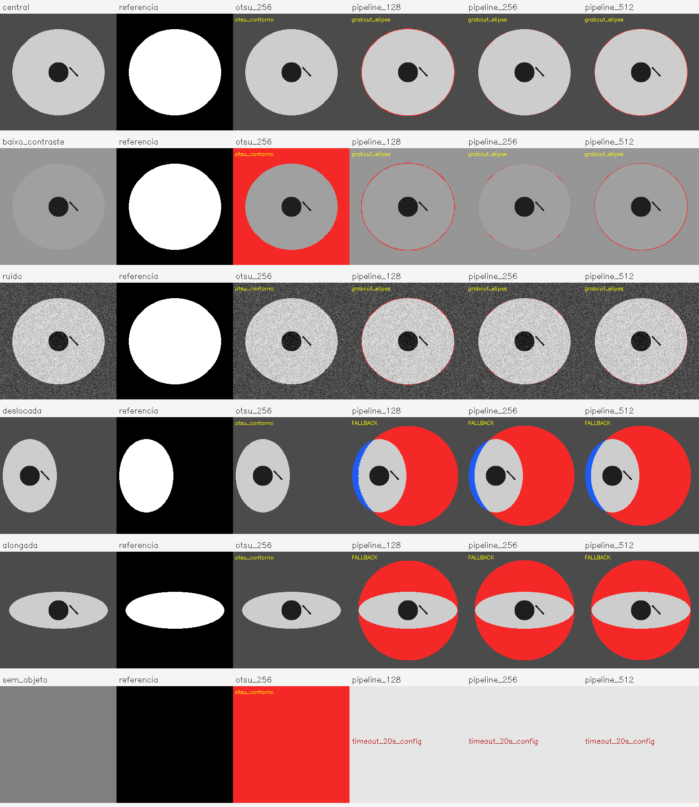

# Estudo de caso: quando a máscara externa exige revisão

**Estado: experimento educacional preparado para revisão, ainda não publicado.**

## Problema e entrega

O pipeline prepara imagens de peças fundidas: padroniza o tamanho, procura a
silhueta externa e realça bordas. Este complemento torna observável uma pergunta
específica: quanto a máscara se afasta de uma silhueta conhecida quando posição,
contraste, ruído e proporção da peça mudam?

O trabalho original, suas imagens e a validação histórica permanecem intactos.
Este experimento não reproduz o lote de 1.300 imagens e não o substitui.

## Protocolo executável

- Seis cenas sintéticas de 256 × 256: peça central, baixo contraste, ruído,
  deslocamento, forma alongada e controle negativo sem objeto.
- Máscara de referência produzida pela geometria usada para desenhar a cena.
  Representa a silhueta externa preenchida, não a superfície de metal nem defeitos.
- Referência simples: cinza, suavização, Otsu para objeto claro, maior contorno
  externo preenchido. Pressupõe objeto mais claro que o fundo.
- Pipeline existente com saída em 128, 256 e 512 pixels, sem alterar seus parâmetros
  internos. A máscara volta a 256 por vizinho mais próximo antes da comparação.
- Uma execução de aquecimento e cinco medições por cena/configuração. Semente
  2026, uma thread OpenCV, reinicialização do RNG antes de cada execução.
- Limite de 20 segundos para o conjunto de repetições de cada configuração,
  incluindo inicialização do processo isolado. Se excedido, registra timeout e
  deixa métricas e tempos vazios; não inventa uma máscara nem trata falha como zero.
  A contagem de timeouts deve acompanhar qualquer comparação de tempos.
- Tempo medido inclui o processamento e a obtenção das etapas intermediárias;
  exclui leitura/gravação, desenho e métricas. Os métodos têm operações diferentes.
  A mediana descreve este ambiente; não é promessa de latência em produção.
- IoU = interseção / união das máscaras. Fração perdida = pixels verdadeiros
  omitidos / área verdadeira. Área falsa = pixels previstos fora da referência /
  área total da imagem. No controle negativo, IoU não é agregada: usa-se área falsa.

Há somente uma cena por condição. As cinco repetições servem para medir tempo,
não são cinco amostras independentes. Não há teste de significância ou inferência
para uma população industrial. As figuras elípticas favorecem a hipótese geométrica
do próprio pipeline; o resultado não comprova generalização.

## Como interpretar as imagens

Em `comparacao.png`, as duas primeiras colunas mostram entrada e referência.
As seguintes mostram erros de máscara: **vermelho** é área incluída indevidamente;
**azul** é parte da silhueta perdida. O restante preserva a imagem original.
`FALLBACK` identifica a alternativa circular que precisa de revisão.
Os arquivos `*_final.png` mostram o processamento final; `*_mascara.png` permitem
inspecionar a segmentação isoladamente.

## Decisões e responsabilidades

O complemento foi implementado com assistência de IA a pedido da titular do
portfólio. Não atribui automaticamente à titular decisões técnicas ou autoria
independente. Antes de publicar, ela pode revisar e explicar: por que o maior
contorno é uma referência útil, por que a máscara inclui cavidades, por que uma
imagem vazia não deve receber uma avaliação positiva e o que o fallback sinaliza.

## Próxima avaliação com dados reais

1. Confirmar acesso e condições de uso das imagens originais.
2. Selecionar imagens sem escolher apenas exemplos favoráveis, documentando o
   critério e a distribuição de condições; separar ajuste e avaliação final.
3. Anotar silhuetas com revisão humana e registrar divergências de anotação.
4. Comparar métodos no mesmo conjunto e registrar falhas, tempos e IoU por imagem.
5. Avaliar defeitos conhecidos separadamente, com rótulos adequados, antes de
   falar em detecção. Para benefício econômico, medir o processo atual e o custo
   real da revisão; tempo de processamento isolado não demonstra economia.

O experimento é uma extensão educacional. Não escolhe o tema definitivo do
Trabalho 3 nem comprova originalidade científica ou viabilidade comercial.

## Resultados desta execução — 27/10/2026

Base revisada: `12217ff59309965db9083029c3c2a630ab3540f9`. Python 3.12.14, NumPy 1.26.4, OpenCV 4.10.0. As 24 combinações produziram 21 resultados e 3 timeouts; os 10 testes passaram. A primeira tentativa sem limite de tempo não produziu relatório completo; seus arquivos parciais não integram estas métricas.

| Cena | Método | IoU | Mediana (ms) | Estado |
| --- | --- | ---: | ---: | --- |
| central | otsu_256 | 1.000 | 0.20 | otsu_contorno |
| central | pipeline_128 | 0.973 | 16.24 | grabcut_elipse |
| central | pipeline_256 | 0.992 | 46.26 | grabcut_elipse |
| central | pipeline_512 | 0.978 | 285.01 | grabcut_elipse |
| baixo_contraste | otsu_256 | 0.459 | 0.26 | otsu_contorno |
| baixo_contraste | pipeline_128 | 0.973 | 27.06 | grabcut_elipse |
| baixo_contraste | pipeline_256 | 0.992 | 114.28 | grabcut_elipse |
| baixo_contraste | pipeline_512 | 0.978 | 1376.77 | grabcut_elipse |
| ruido | otsu_256 | 0.999 | 0.17 | otsu_contorno |
| ruido | pipeline_128 | 0.979 | 21.25 | grabcut_elipse |
| ruido | pipeline_256 | 0.992 | 84.40 | grabcut_elipse |
| ruido | pipeline_512 | 0.991 | 359.09 | grabcut_elipse |
| deslocada | otsu_256 | 1.000 | 0.26 | otsu_contorno |
| deslocada | pipeline_128 | 0.333 | 14.71 | fallback_circulo_verificar |
| deslocada | pipeline_256 | 0.335 | 46.95 | fallback_circulo_verificar |
| deslocada | pipeline_512 | 0.335 | 301.98 | fallback_circulo_verificar |
| alongada | otsu_256 | 1.000 | 0.19 | otsu_contorno |
| alongada | pipeline_128 | 0.364 | 15.53 | fallback_circulo_verificar |
| alongada | pipeline_256 | 0.363 | 47.26 | fallback_circulo_verificar |
| alongada | pipeline_512 | 0.363 | 309.10 | fallback_circulo_verificar |
| sem_objeto | otsu_256 | — | 0.22 | otsu_contorno |
| sem_objeto | pipeline_128 | — | — | timeout_20s_config |
| sem_objeto | pipeline_256 | — | — | timeout_20s_config |
| sem_objeto | pipeline_512 | — | — | timeout_20s_config |

### Interpretação

- No baixo contraste, o pipeline de 256 pixels atingiu IoU 0,992, contra 0,459 da referência simples. Isso é sobreposição da silhueta sintética, não acurácia de defeitos.
- Nas cenas deslocada e alongada, o fallback circular reduziu a IoU para aproximadamente 0,335 e 0,363. A referência Otsu foi melhor nesses exemplos. Não há vencedor universal.
- Na entrada sem objeto, Otsu marcou toda a imagem como objeto (área falsa = 100%). As três configurações do pipeline excederam o limite de 20 segundos por configuração. Não temos uma máscara avaliada dessas execuções interrompidas.
- Aumentar a resolução para 512 elevou o custo e não trouxe ganho consistente de IoU neste conjunto. A entrada possui apenas 256 pixels e não ganha informação por ampliação.
- Um próximo ajuste deve tratar entradas sem objeto e tornar o fallback explicitamente rejeitável. Deve ser avaliado separadamente antes de substituir a versão original.

Evidências: [CSV completo](demo_2026_10_27/metricas.csv), [ambiente e hashes](demo_2026_10_27/ambiente.json) e [log dos testes](demo_2026_10_27/testes.txt).

A demonstração melhora a capacidade de inspecionar e reproduzir o projeto. Não comprova que o algoritmo original ficou mais preciso, nem justifica atribuir uma nota predeterminada ao portfólio.
